<div align="center">


# WongWongLinares La Salle

### FuturoIng — Self-Driving Vehicle

**WRO&nbsp;2026 · Future&nbsp;Engineers** &nbsp;·&nbsp; **Panamá** 🇵🇦

<sub>This repository contains the engineering materials of a self-driven vehicle's model<br>competing in the WRO Future Engineers competition, season&nbsp;2026.</sub>

<p>
  
  
  
</p>
<p>
  
  
  
  
</p>

</div>

---

## 📑 Table of Contents

- [🏎️ Overview](#-overview)
- [📂 Content](#-content)
- [🧩 Introduction](#-introduction)
- [🔩 Materials & Specs](#-materials)
- [🔌 Wiring](#-wiring)
- [🤖 Vehicle Gallery](#-vehicle-gallery)
- [🎥 Video](#-video)
- [🛠️ Engineering Journey](#-engineering-journey)
- [⚙️ UNO Q Gotchas](#-uno-q-gotchas)
- [👥 Team](#-team)

---

## 🏎️ Overview

An autonomous vehicle built on the **Arduino UNO Q** (App Lab) for the **WRO Future
Engineers** challenge. It steers with a servo, drives with a DC motor through a
**Modulino Motors** driver, centers itself in the corridor with **3× Modulino Distance**
(ToF) sensors on a **Modulino Hub**, turns exact 90° corners with an **MPU‑6050** gyro
soldered directly to the Hub's I²C pass-through pads, and carries a **LDROBOT LD19**
360° lidar and a Logitech camera for future obstacle/line work.

> [!NOTE]
> This project **migrated** from a first, more "learning-hardware" build (L298N driver +
> HC‑SR04 ultrasonic + a bare MPU‑6050 on A4/A5) to this Modulino-based ecosystem to use
> more modern, plug‑and‑play, I²C-addressable modules. The migration story — including the
> Wire/Wire1 bus conflict we hit and fixed — is in
> [`other/fabrication-challenges.md`](other/fabrication-challenges.md).

```
Browser panel ──WebSocket──▶ Python (Web UI brick) ──RouterBridge RPC──▶ sketch ──▶ servo (pin 5) + Modulino Motors/Distance/Buttons/Hub + MPU-6050
```

> [!NOTE]
> The **Python / Linux side** serves the Web UI and forwards commands to the MCU over
> the RouterBridge; the **sketch / MCU side** runs the real-time gyro steering and motor
> control.

---

## 📂 Content

This repository follows the official **WRO Future Engineers** engineering-materials template:

- **`src`** — control software for every programmed component, plus all build/dependency artifacts (`sketch.yaml`, `requirements.txt`).
- **`v-photos`** — 6 photos of the vehicle (every side, top and bottom).
- **`t-photos`** — team photo.
- **`video`** — `video.md` with the link to the driving-demonstration video.
- **`schemes`** — schematic diagrams of the electromechanical components and how they connect.
- **`other`** — supporting documentation, build notes and the project website.
- **`images`** — branding and reference images used by this README.

> [!NOTE]
> The optional `models/` folder (3D‑print / laser / CNC files) is omitted — the WRO
> template allows removing it when there is nothing to add.

<details>
<summary><b>📁 Folder map</b></summary>

<br>

| Folder | Contents |
|--------|----------|
| 📂 [`src`](src/) | Arduino sketch, Python Web UI, web assets + build artifacts |
| 📷 [`v-photos`](v-photos/) | Vehicle photos (every side, top & bottom) |
| 👥 [`t-photos`](t-photos/) | Team photo |
| 🎥 [`video`](video/) | Driving-demonstration video link |
| 🔌 [`schemes`](schemes/) | Wiring / electronic schematics |
| 📦 [`other`](other/) | Docs, build notes & project website |
| 🖼️ [`images`](images/) | README branding & reference images |

</details>

---

## 🧩 Introduction

### 🧠 Code modules & how they map to the hardware

| Module | Where | Role |
|--------|-------|------|
| **Sensing** | `src/sketch/sketch.ino` | 3× Modulino Distance (wall centering + corner detect) + MPU‑6050 (heading) + Modulino Buttons |
| **Logic** | `src/sketch/sketch.ino` | Runs **on the MCU, in real time**: wall-centering P control + fixed-90° gyro turns + 12-corner lap counter |
| **Actuation** | `src/sketch/sketch.ino` | Steering servo on **pin 5** + DC drive motor via **Modulino Motors** |
| **Interface / extra senses** | `src/python/main.py` + `src/python/lidar_ld19.py` + `src/assets` | Web UI (Socket.IO) + camera stream + LD19 lidar 360° scan + RouterBridge RPC bridge to the MCU |

> [!IMPORTANT]
> **Architecture change from the diagram below:** in this Modulino-based build the
> real-time driving FSM (wall centering, corner detection, 90° turns) runs **entirely in
> `sketch.ino` on the MCU**, not in Python — the 3 distance sensors need to be polled every
> loop cycle, and round-tripping that over the RouterBridge RPC to Python would be too slow.
> Python (`main.py`) now owns only the web panel, camera, lidar, and two *extra* corner
> triggers it can push to the sketch (`Bridge.call("camera_corner", ...)`): a colour-line
> detector (`_detect_corner_line`, orange/blue) and a lidar front-sector check
> (`lidar.sector_min_mm(0, 15)`), both meant as backups for when the front distance sensor
> alone isn't trusted yet (see the engineering journal for why).

### 🏁 Autonomous run — current status

The files below (`stage1_open.py`, `stage2_obstacle.py`, `fsm.py`, `vision.py`,
`bridge_io.py`) are **kept from the previous, camera-vision-based architecture** and are
not deleted, but the currently-flashed program is the simpler sketch-only FSM described
above (`src/sketch/sketch.ino` + `src/python/main.py`). It currently implements the
**Open Challenge** (wall-centering + 12-corner lap counter); Obstacle-challenge pillar
logic has not been ported to this architecture yet.

**Shared / previous architecture (kept for reference, not currently flashed):**
- [`src/python/stage1_open.py`](src/python/stage1_open.py) / [`stage2_obstacle.py`](src/python/stage2_obstacle.py) — the earlier camera-vision-driven stage entry points.
- [`src/python/vision.py`](src/python/vision.py) — perception: `detect_lines` (orange/blue), `decide_open`, `decide_obstacle`, wall centering.
- [`src/python/fsm.py`](src/python/fsm.py) — the earlier 3-lap state machine (`RaceController`).
- [`src/python/bridge_io.py`](src/python/bridge_io.py) — thin RPC wrappers to the MCU.

> [!IMPORTANT]
> Every threshold (corner distance, P gain, turn timing) is a **starting point to tune on
> the real mat** — the front distance sensor's reading depends a lot on its exact mounting
> height/angle above the mat (see the journal). Full rationale is in
> [`other/fabrication-challenges.md`](other/fabrication-challenges.md).

### ⚙️ How it works

**Sketch ([`src/sketch/sketch.ino`](src/sketch/sketch.ino))** registers RPC handlers with
`Bridge.provide_safe(...)`:

```cpp
Bridge.provide_safe("set_angle", set_angle);   // servo.write(angle), returns applied angle
Bridge.provide_safe("get_angle", get_angle);   // lets the UI sync on connect
```

> [!WARNING]
> `provide_safe` (not `provide`) is required for anything that touches hardware. It runs
> the callback in the `loop()` context; `provide` runs it on a background RPC thread where
> `servo.write()` / GPIO can misbehave.

**Python ([`src/python/main.py`](src/python/main.py))** exposes simple REST endpoints; a
handler parameter becomes a query parameter (FastAPI):

```python
ui = WebUI()
ui.expose_api("GET", "/api/angle", api_set_angle)  # /api/angle?angle=120
applied = Bridge.call("set_angle", angle)          # python -> MCU
return {"angle": applied}
```

> [!TIP]
> **Why REST and not websockets?** This brick is FastAPI + `fastapi_socketio` and does
> **not** serve a Socket.IO *client* library, so an `io()` page hangs on "Connecting…".
> Plain `fetch()` is rock-solid here.

### 🔧 The library fix (why `Servo.h` wasn't found)

Arduino App Lab does **not** read the classic Arduino IDE library folder. It resolves each
project's MCU libraries from **[`src/sketch/sketch.yaml`](src/sketch/sketch.yaml)**.
`Servo 1.3.0` is the first version with Zephyr / UNO Q support, and App Lab needs the
**profiles** form:

```yaml
profiles:
  default:
    fqbn:                       # left blank — App Lab fills it from the connected UNO Q
    platforms:
      - platform: arduino:zephyr
    libraries:
      - Servo (1.3.0)
default_profile: default
```

### ▶️ Build, compile & upload

1. Open **Arduino App Lab** → open this app.
2. Connect the UNO Q, select it, and click **Run** (compiles + uploads the sketch, starts the Python program).
3. Open the app's **Web UI** (or `http://<board-ip>:7000`) and drive.

> [!NOTE]
> Verify: the build succeeds with no `Servo.h: No such file or directory`, the page shows
> **Connected**, and the servo physically tracks the slider.

<details>
<summary><b>🛠️ Current build — Modulino + gyro + lidar (reference)</b></summary>

<br>

The current robot (servo steering + Modulino Motors DC motor) uses the same
`Arduino_RouterBridge` pattern, plus `Arduino_Modulino` for the Hub/Distance/Buttons/Motors
and a raw `Wire1` MPU-6050 for heading:

```cpp
#include <Arduino_Modulino.h>
#include <Servo.h>
#include <Arduino_RouterBridge.h>
#include <Wire.h>

const uint8_t PIN_SERVO = 5;   // signal pin (pin 3 died during rework, moved to 5)
const int SERVO_CENTER = 77;

ModulinoHub hub;
ModulinoButtons buttons;
ModulinoDistance distIzq(hub.port(2));
ModulinoDistance distCentro(hub.port(7));
ModulinoDistance distDer(hub.port(3));
ModulinoMotors motors;
Servo servoDireccion;

// MPU-6050 soldered to the Hub's own SDA/SCL/3V3/GND pass-through pads --
// shares Wire1 with Modulino, avoiding the Wire/Wire1 bus conflict (see the
// engineering journal for the full diagnosis).
const uint8_t MPU_ADDR = 0x68;

void setup() {
  Bridge.begin();
  Modulino.begin();
  buttons.begin(); distIzq.begin(); distCentro.begin(); distDer.begin(); motors.begin();
  servoDireccion.attach(PIN_SERVO);
  servoDireccion.write(SERVO_CENTER);
  // mpuBegin() / mpuCalibrate() -- WHO_AM_I check + gyro bias, robot must be still
}
void loop() { /* wall-centering P control + gyro 90-degree corner turns, see src/sketch/sketch.ino */ }
```

</details>

---

## 🔩 Materials

The vehicle's components — quantity, a key spec, and role. Full **sourced
specifications** are in the collapsible block below.

| Component | Image | Qty | Key spec | Role |
|-----------|:-----:|:---:|----------|------|
| **Arduino UNO Q** | 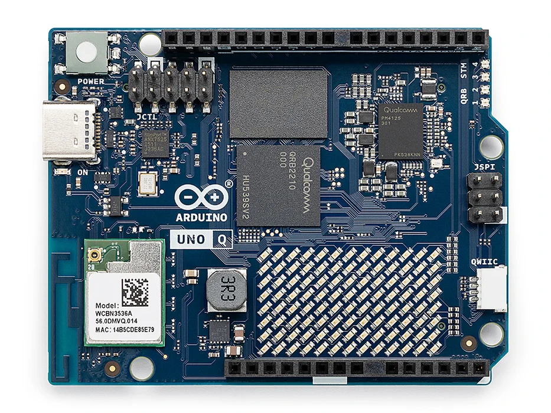 | 1 | QRB2210 quad-A53 + STM32U585 | Main controller (Linux SBC + MCU), App Lab |
| **Modulino Hub** (ABX00100) | 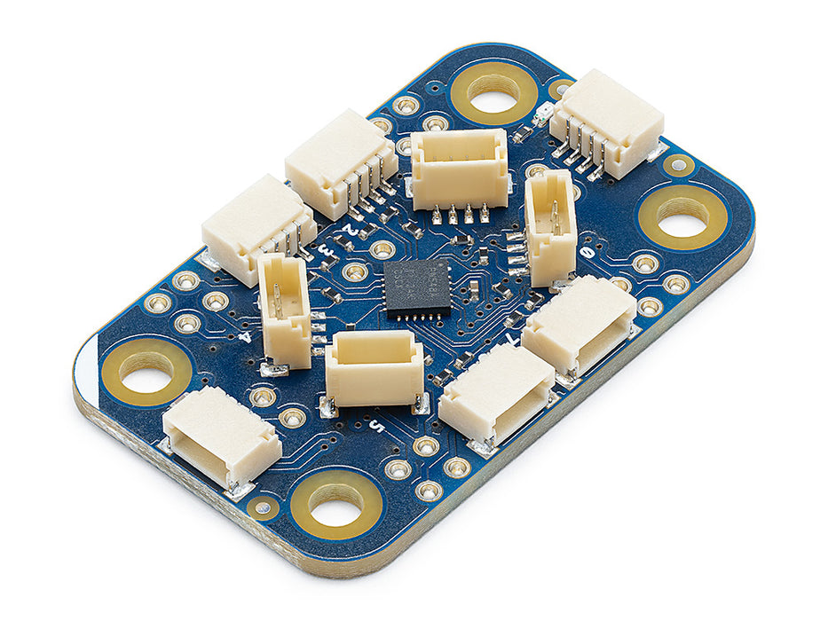 | 1 | I²C mux, 8 Qwiic channels | Fans out one I²C bus so same-address modules (the 3 Distance sensors) don't collide |
| **Modulino Motors** | 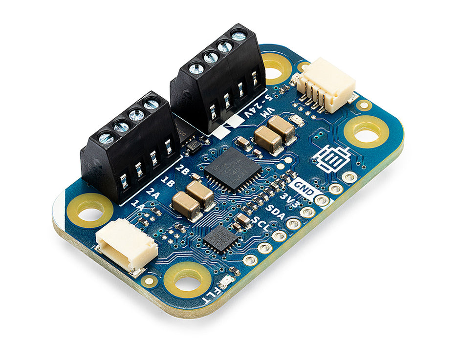 | 1 | Qwiic DC motor driver | Drives the DC motor; replaces the L298N |
| **Modulino Buttons** | 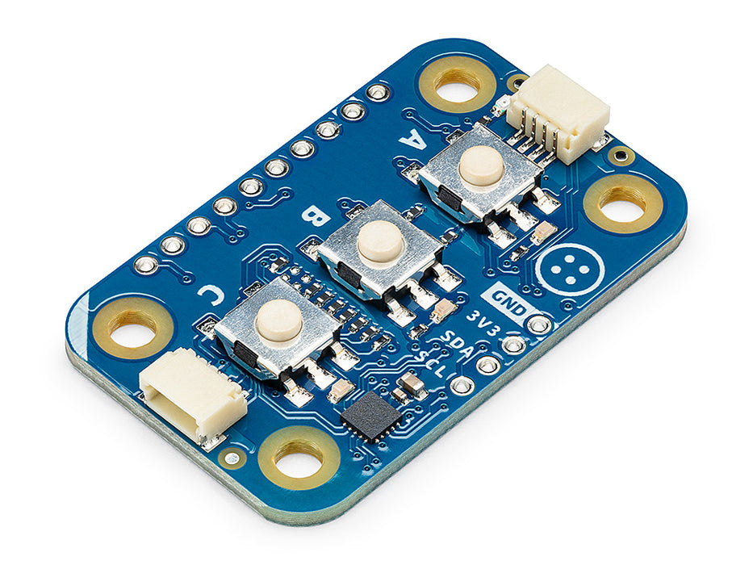 | 1 | 3 buttons + LEDs, Qwiic | Start/stop control, chained after the Hub |
| **Modulino Distance ×3** | 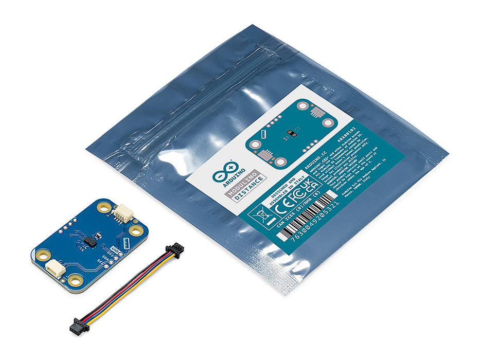 | 3 | VL53L4CD ToF, I²C (fixed addr 0x29) | Left/center/right corridor distance — each on its **own** Hub channel |
| **DC drive motor** | 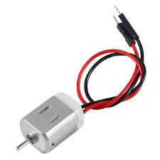 | 1 | brushed gearmotor (from a disassembled LEGO EV3 motor, driven raw — no encoder) | Propels the vehicle (via Modulino Motors) |
| **Steering servo** | 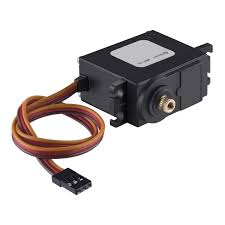 | 1 | PWM, 4.8–6 V, ~180° | Steers the front wheels (signal on **pin 5**) |
| **MPU-6050 (GY-521)** | 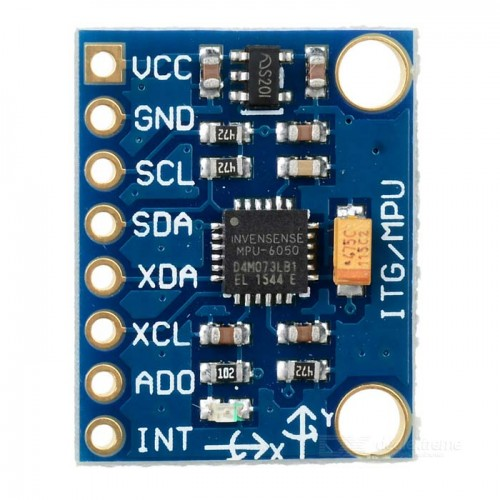 | 1 | 6-axis, ±2000 °/s, I²C | Gyro heading hold — soldered to the Hub's own `Wire1` pass-through pads (see gotchas below) |
| **LDROBOT LD19** lidar | *(photo pending)* | 1 | 2D ToF, 360°, ~10 Hz, via USB-serial (CP210x) | 360° scan; front-sector backup for corner detection |
| **Logitech C930e camera** | 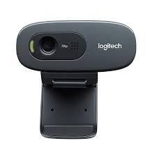 | 1 | USB UVC | Live panel view; colour-line corner-detection backup |
| **Battery** | 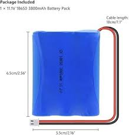 | 1 | 11.1 V 3S 18650, ~3800 mAh | Main power supply |
| **Jumper cables** | 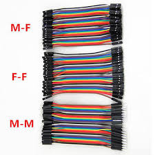 | as needed | Dupont, 2.54 mm pitch | Wiring between modules |

> [!NOTE]
> **Retired from the first build:** the L298N dual H-bridge and the HC-SR04 ultrasonic
> sensor are no longer used — replaced respectively by Modulino Motors and the 3 Modulino
> Distance sensors. Kept in `images/components/` for historical reference.

<details>
<summary><b>📋 Full component specifications (researched & sourced)</b></summary>

<br>

> [!NOTE]
> Electronics specs (UNO Q, L298N, MPU-6050) are confirmed against official
> datasheets/pages. Items tagged **representative** are typical values for that class of
> part — the exact model isn't confirmed; verify against the real hardware.

#### 🧠 Arduino UNO Q
- **Application processor:** Qualcomm Dragonwing QRB2210 — quad-core Arm Cortex-A53 @ 2.0 GHz (runs Debian Linux)
- **Real-time MCU:** STM32U585 — Arm Cortex-M33 @ 160 MHz, 2 MB flash, 786 kB SRAM
- **RAM / storage:** 2 GB LPDDR4 + 16 GB eMMC (or 4 GB + 32 GB variant)
- **Wireless:** Wi-Fi 5 (2.4/5 GHz) + Bluetooth 5.1
- **USB / power:** USB-C (host/device, video out); 5 V @ 3 A, VIN 7–24 V
- **I/O:** UNO headers + Qwiic; I²C/SPI/UART/PWM/CAN/ADC/GPIO; 8×13 LED matrix, 4 RGB LEDs
- **Dimensions:** 68.85 × 53.34 mm
- Sources: [store.arduino.cc](https://store.arduino.cc/products/uno-q) · [docs.arduino.cc](https://docs.arduino.cc/hardware/uno-q/)

#### ⚙️ L298N dual H-bridge motor driver
- **Motor supply:** up to 46 V max (typical use 5–35 V)
- **Logic supply:** 5 V (onboard 78M05 regulator when Vs ≤ 12 V)
- **Current:** 2 A continuous per channel (4 A total), 3 A peak (non-repetitive)
- **Channels:** 2 full H-bridges → 2 DC motors bidirectional
- **Based on:** STMicroelectronics L298 dual full-bridge driver
- Sources: [ST L298 datasheet](https://www.st.com/resource/en/datasheet/l298.pdf) · [components101](https://components101.com/modules/l293n-motor-driver-module)

#### 🧭 GY-521 (MPU-6050) 6-axis IMU
- **Sensors:** 3-axis gyroscope + 3-axis accelerometer (6 DOF) + temperature
- **Ranges:** gyro ±250/500/1000/2000 °/s; accel ±2/4/8/16 g (programmable)
- **Interface:** I²C ≤ 400 kHz; address 0x68 (0x69 if AD0 = high)
- **Voltage:** module 3.3–5 V (onboard regulator)
- **DMP:** onboard Digital Motion Processor (offloads motion fusion)
- Sources: [protosupplies](https://protosupplies.com/product/mpu-6050-gy-521-3-axis-accel-gryo-sensor-module/) · [datasheet](https://mysii.gorriens.net/images/arduino/capteurs/gy-521_mpu-6050_3-axis_gyroscope_and_acceleration_sensor_en.pdf)

#### 🎚️ Steering servo &nbsp;·&nbsp; *representative (SG90-class)*
- **Voltage:** 4.8–6 V DC
- **Torque:** ~1.8 kg·cm @ 4.8 V → ~2.2 kg·cm @ 6 V
- **Speed:** ~0.1 s/60°
- **Rotation:** ~180°; **weight** ~9 g
- **Interface:** 3-wire PWM (50 Hz, 1–2 ms pulse, 1.5 ms ≈ centre)
- Sources: [components101](https://components101.com/motors/servo-motor-basics-pinout-datasheet) · [servodatabase](https://servodatabase.com/servo/towerpro/sg90) — *confirm exact model*

#### 🔁 DC drive motor &nbsp;·&nbsp; *representative (TT/N20-class)*
- **Type:** brushed DC motor with reduction gearbox
- **Voltage:** ~3–6 V typical (hobby car motor)
- **No-load RPM:** ~150–200 RPM (TT gearmotor at 5–6 V)
- **No-load current:** ~120–180 mA
- **Note:** the L298N drops ~2 V, so effective motor voltage is below the supply rail
- Sources: [zbotic](https://zbotic.in/tt-gear-motor-for-robot-car-voltage-rpm-tire-matching/) · [lastminuteengineers](https://lastminuteengineers.com/l298n-dc-stepper-driver-arduino-tutorial/) — *confirm exact model*

#### 📷 Logitech USB camera &nbsp;·&nbsp; *representative (C270-class)*
- **Resolution:** 1280 × 960 (1.2 MP); video up to 720p @ 30 fps
- **Field of view:** ~60° diagonal
- **Connection:** USB 2.0, UVC plug-and-play (works with V4L2 / OpenCV, no vendor driver)
- Sources: [Logitech C270 specs](https://support.logi.com/hc/en-us/articles/360023462093-Logitech-HD-Webcam-C270-Technical-Specifications) — *confirm exact model (a C920 would be 1080p / ~78° FOV)*

#### 🔋 Battery — 11.1 V 3S 18650 Li-ion pack
- **Chemistry / config:** Lithium-ion 18650, 3S (3 cells in series)
- **Voltage:** 11.1 V nominal, 12.6 V full charge, ~9.0–9.2 V cutoff
- **Capacity:** ~3800 mAh (≈42 Wh)
- **Protection:** typically a BMS (over-charge / over-discharge / short)
- **Note:** powers the L298N rail + electronics; charge with a 12.6 V 3S charger, never below cutoff
- Sources: [Ufine](https://www.ufinebattery.com/products/11-1-v-3000mah-18650-battery-pack-18650-3s/) · [Rytronics](https://www.rytronics.in/product/11-1v-2600mah-18650-3s-1c-li-ion-battery-pack-with-bms/) — *11.1 V/3S confirmed; capacity representative*

#### 🔌 Dupont jumper wires
- **Pitch:** 2.54 mm (0.1") — matches headers/breadboards
- **Gauge:** ~24–28 AWG stranded copper
- **Types:** male-male, male-female, female-female; **length** ~10/20/30 cm
- **Rating:** ~3 A per contact; friction-fit (can loosen under vibration)
- Source: [Keszoox DuPont guide](https://keszoox.com/blogs/news/dupont-connector-complete-guide)

</details>

---

## 🔌 Wiring

| Servo wire | Connect to |
|------------|------------|
| Signal (orange/white) | **pin 5** |
| V+ (red) | UNO Q **5V** pin |
| GND (brown/black) | UNO Q **GND** (shared ground) |

<div align="center">
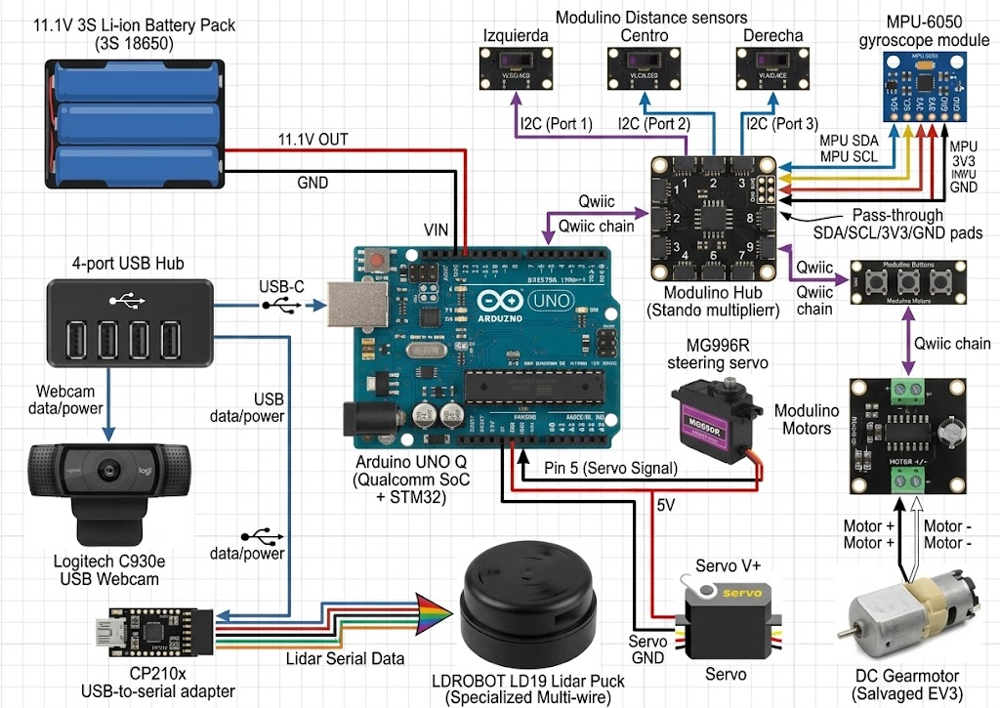
</div>

> [!NOTE]
> `schemes/wiring.png` (kept, not deleted) shows the **previous** L298N + HC-SR04 build.
> `schemes/wiring-modulino.png` above is the current one.

<details>
<summary><b>🔧 Full pin map (current build)</b></summary>

<br>

| Signal | Pin / Port | Notes |
|--------|-----|-------|
| Steering servo | **pin 5** | Pin 3 was used originally but died during rework; moved to pin 5 |
| Modulino chain | Qwiic (I²C) | UNO Q → **Modulino Hub** → **Modulino Buttons** → **Modulino Motors** (daisy-chained on the Hub's main, unmuxed port) |
| Modulino Distance — Izquierda | Hub channel **2** | VL53L4CD, own channel (fixed I²C addr 0x29 collides if chained) |
| Modulino Distance — Centro | Hub channel **7** | Used for corner/front-wall detection |
| Modulino Distance — Derecha | Hub channel **3** | |
| MPU-6050 SDA / SCL / 3V3 / GND | **soldered to the Hub's own pass-through pads** | NOT A4/A5 — the UNO Q's `Modulino.begin()` uses `Wire1` (i2c4), not `Wire` (i2c2/A4-A5); mixing the two on one sketch hangs the whole I²C bus. See the journal for the full diagnosis. |
| LD19 lidar | USB (via CP210x USB-serial adapter) | `/dev/ttyUSB0`, 230400 baud, 47-byte packets |
| Logitech camera | USB | via the same USB hub as the lidar adapter |

</details>

---

## 🤖 Vehicle Gallery

<div align="center">

| 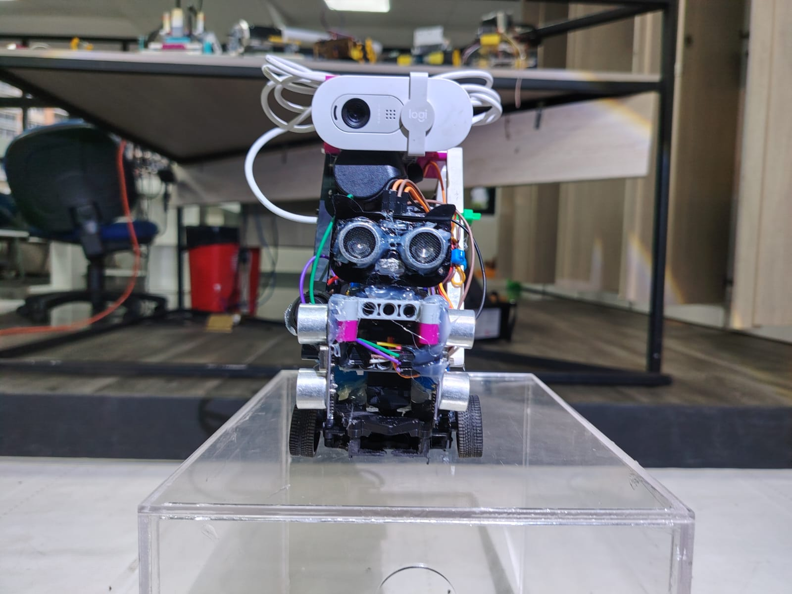 | 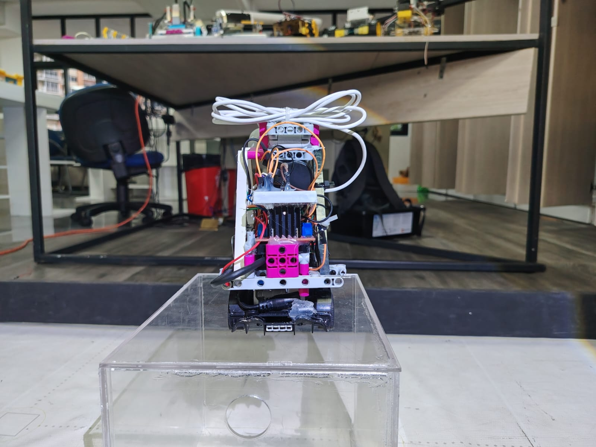 | 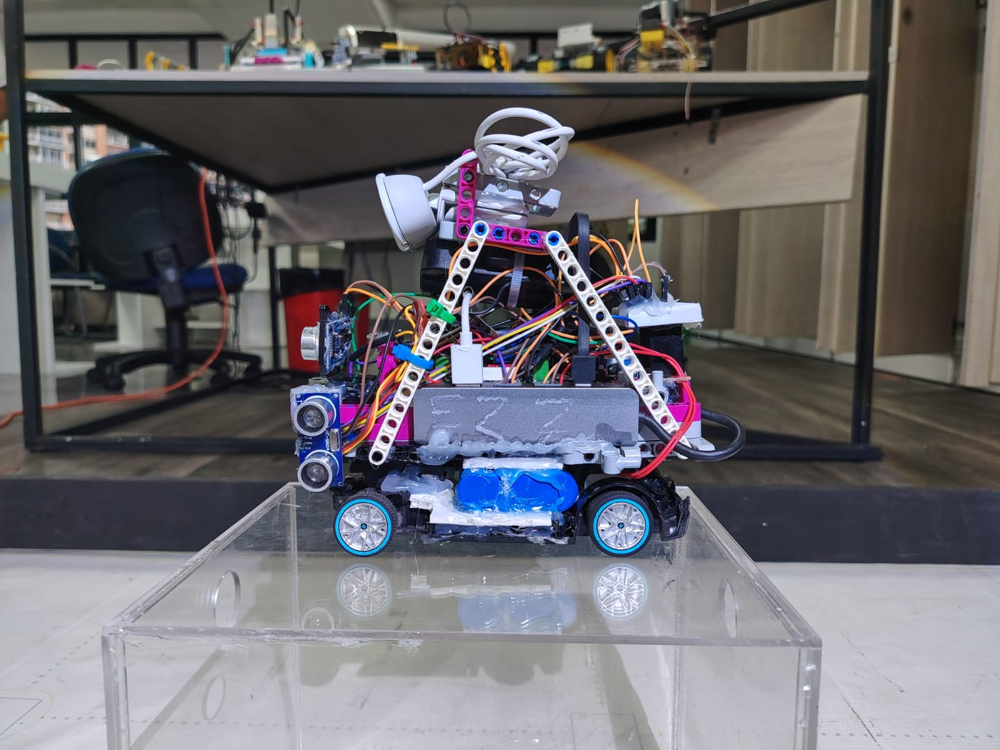 |
|:--:|:--:|:--:|
| **Front** | **Back** | **Left** |
| 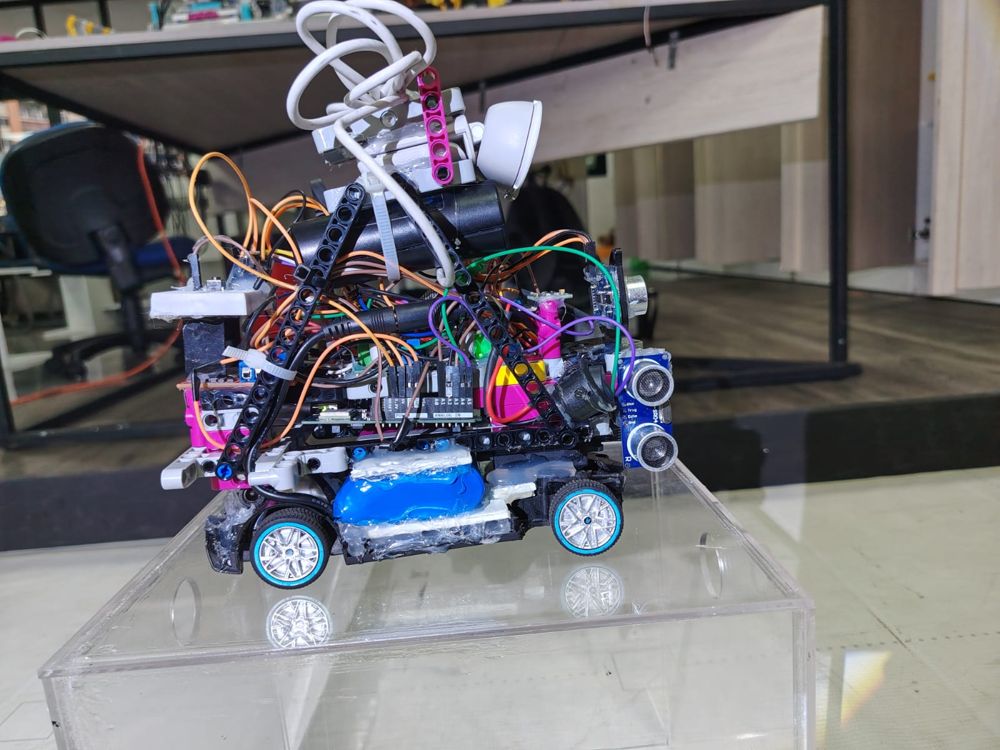 | 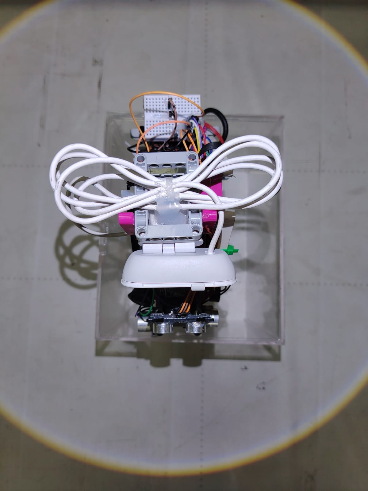 | 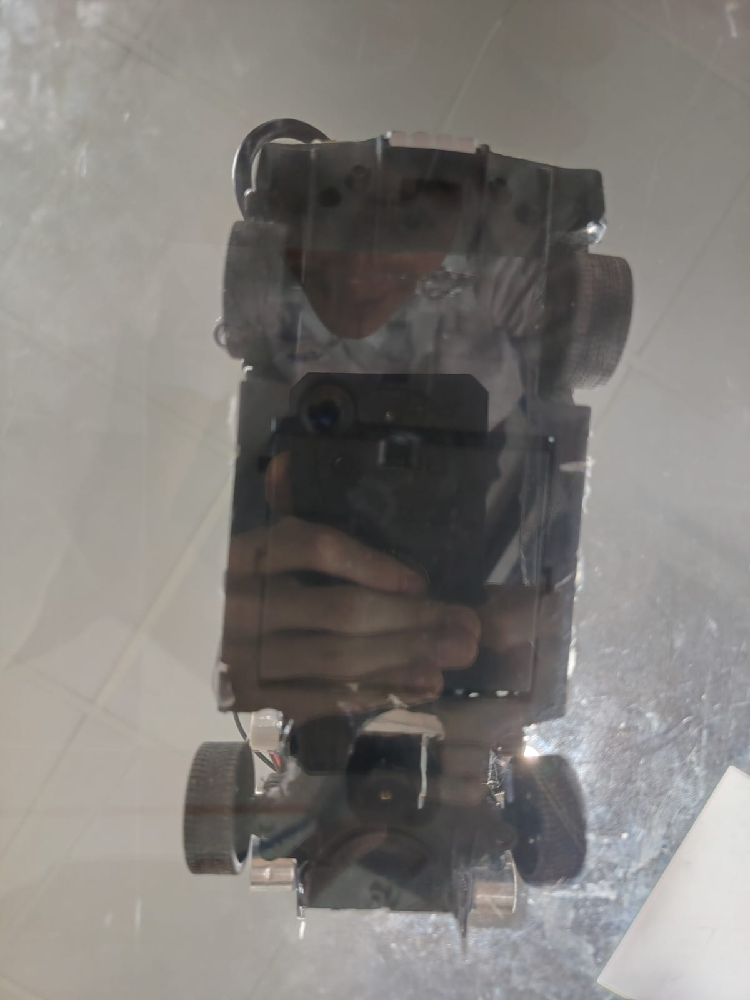 |
| **Right** | **Top** | **Bottom** |

</div>

---

## 🎥 Video

<div align="center">

<a href="https://www.youtube.com/shorts/cSLZId9H9bs">
  
</a>

**▶️ [Watch the Open Challenge run (Stage 1)](https://www.youtube.com/shorts/cSLZId9H9bs)**

</div>

The link is also recorded in [`video/video.md`](video/video.md).

---

## 🛠️ Engineering Journey

> [!NOTE]
> The full story of the problems we solved — the Raspberry Pi first version, the servo‑PWM
> issue, the switch to the Arduino UNO Q, and the web‑UI servo calibration (**centre = 79°**)
> — is written up in **[`other/fabrication-challenges.md`](other/fabrication-challenges.md)**.

---

## ⚙️ UNO Q Gotchas

> [!WARNING]
> - **PWM pins:** on Zephyr `servo.attach(pin)` needs a hardware-PWM pin. A GPIO pin can
>   also just die from rework/handling (happened to us on pin 3) — try another PWM pin if
>   the servo goes silent with no code change.
> - Keep **Servo ≥ 1.3.0** in `sketch.yaml`, plus every transitive Modulino dependency
>   declared explicitly (`Arduino_Modulino`, `STM32duino VL53L4CD`/`VL53L4ED`,
>   `Arduino_LSM6DSOX`, `Arduino_LPS22HB`, `Arduino_HS300x`, `Arduino_LTR381RGB`) — App Lab
>   does **not** auto-resolve them from what's merely installed, only from `sketch.yaml`.
> - **`Modulino.begin()` on the UNO Q defaults to `Wire1` (i2c4), not `Wire` (i2c2 / the
>   classic A4-A5 bus)** — this cost us the most debugging time in this migration. Using a
>   raw `Wire` (or even a second `Wire1` reference) transaction for a non-Modulino I²C
>   device in the *same sketch* as Modulino reliably breaks **all** Modulino traffic
>   (Buttons/Distance/Motors), success or failure of that transaction notwithstanding. Fix:
>   share `Wire1` for everything — we soldered the MPU-6050 straight to the Hub's own
>   SDA/SCL/3V3/GND pass-through pads instead of A4/A5.
> - Same-address I²C modules (all 3 Distance sensors share the fixed VL53L4CD address
>   `0x29`) **must** each sit on their own numbered Hub channel — chaining them like
>   Buttons/Motors puts them all on the same bus segment and none of them respond reliably.
> - A `Bridge.provide`-registered function that writes to a Modulino device on **every**
>   `loop()` iteration (instead of only on state changes / throttled) can flood the I²C bus
>   enough to hang it — and with it the whole sketch, since `Wire1` has no transaction
>   timeout in this driver stack. Throttle hardware writes (~10/s is plenty).
> - Use App Lab's **`Monitor`**, not the classic IDE Serial Monitor.

---

## 👥 Team

**Robotech La Salle** — La Salle, Panamá 🇵🇦

<div align="center">

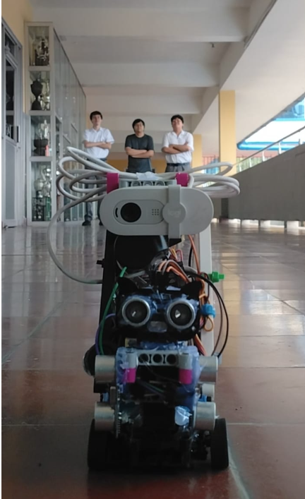

</div>

<div align="center">
<br>

<br>
<sub>Built by <b>Robotech La Salle</b> · Panamá 🇵🇦 · WRO 2026 — Future Engineers</sub>
</div>
